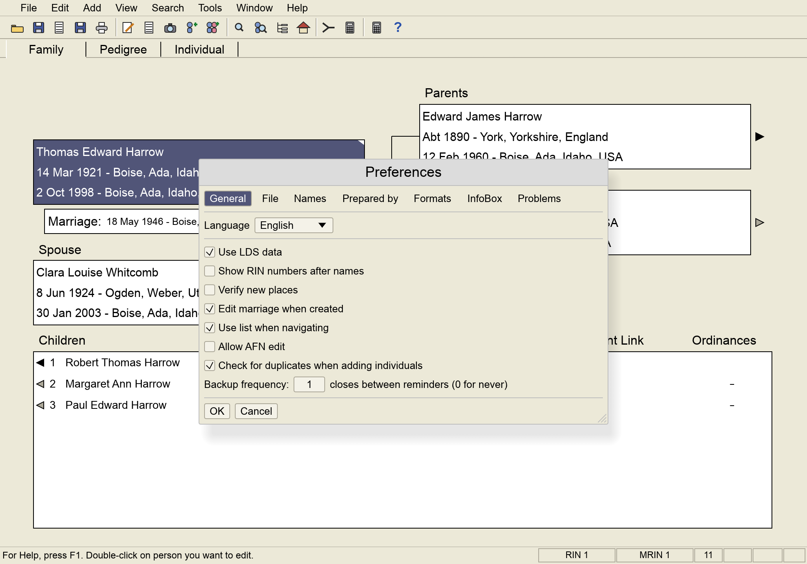

<p align="center"></p>

<h1 align="center">PAF Classic</h1>

<p align="center">
  <b>The family-history program you remember, on today's computers.</b><br>
  Free for personal and nonprofit use · macOS, Windows and Linux · Works offline
</p>

<p align="center">
  <a href="https://github.com/dgmcint/PAF-Classic/releases/latest"><b>⬇ Download the latest version</b></a>
  &nbsp;·&nbsp;
  <a href="https://github.com/dgmcint/PAF-Classic/actions/workflows/release.yml"></a>
</p>

<p align="center"></p>

For decades, Personal Ancestral File (PAF) was how millions of people kept their
family history. It hasn't run well on modern computers for years. **PAF Classic**
brings back the way it worked — the same screens, the same menus, the same
keyboard shortcuts — as a new program for current Macs, Windows PCs and Linux.

If you used PAF 5, you'll feel at home. If you didn't, it's a simple, private
way to record your family without an account or an internet connection.

## What it does

**Your family at a glance**
- **Family screen** with a person, their spouse, parents and children, just like PAF 5
- **Pedigree screen** for ancestors, generation by generation
- **Individual list** you can sort and arrange, with columns you choose

**Recording people**
- Names, births, christenings, deaths, burials, marriages and other events
- Notes, sources and repositories, addresses and pictures
- LDS ordinance fields
- Add parents, spouses and children straight from the Family screen

**Finding and fixing**
- Search by name, record number or custom filters
- Match/Merge to find and combine duplicate people
- Check/Repair, Global Search and Replace, and changing names from CAPITALS to Mixed Case
- Search a person on FamilySearch, Ancestry, Genealogy.com or RootsWeb in one click

**Printing**
- Pedigree charts, family group records, ancestor and descendant reports,
  narrative books, individual summaries, lists and a birthday calendar
- Blank pedigree charts and family group records to fill in by hand
- Everything saves as a PDF you can print or share, and you can make a simple family web page

**Tools**
- Relationship, Date and Soundex calculators
- A notepad for research notes
- Backup and Restore

See [**FEATURES.md**](FEATURES.md) for a full list of what works, compared with the PAF 5 User's Guide, and what's planned next.

## Download and install

Open the [**Releases page**](https://github.com/dgmcint/PAF-Classic/releases/latest)
and download the file for your computer:

| Your computer | Download |
| --- | --- |
| Mac with Apple Silicon (M1, M2, M3, M4…) | `PAF-Classic-macos-apple-silicon.zip` |
| Mac with an Intel processor | `PAF-Classic-macos-intel.zip` |
| Windows 10 or 11 | `PAF-Classic-windows-x64.zip` |
| Linux (64-bit) | `PAF-Classic-linux-x64.tar.gz` |

<details>
<summary><b>Which Mac do I have?</b></summary>

Click the Apple menu  → **About This Mac**. If it says **Chip: Apple M…**,
choose Apple Silicon. If it says **Processor: Intel**, choose Intel.
</details>

**Mac:** open the zip, drag **PAF Classic** into your Applications folder, then
**right-click it and choose Open** the first time. macOS asks once because the
app isn't registered with Apple; after that it opens normally.

**Windows:** open the zip and run **PAF Classic.exe**. If a blue "Windows
protected your PC" box appears, click **More info → Run anyway**.

**Linux:** unpack the file and run `./paf-classic`. For Chinese, Japanese or
Korean names, install a CJK font such as `fonts-noto-cjk`.

## Getting started

- **Try it first:** choose **Help → Open Sample Family** to explore with made-up people.
- **Start fresh:** choose **File → New**, then double-click the dark box on the
  Family screen and type your name, with slashes around the surname: `Mary Ann /Lee/`.
- **Bring in your old PAF file:** choose **File → Open** and pick your `.paf`
  file, then **File → Save As** to keep it as a PAF Classic file. Your original
  `.paf` file is never changed.
- **Bring in a GEDCOM:** choose **File → Import** for a `.ged` file from
  FamilySearch, Ancestry or almost any other family-history program.
- **Help → Getting Started** and **Help → Keyboard** explain the rest.

## Your files

| Ending | What it is | PAF Classic can… |
| --- | --- | --- |
| `.pafc` | A PAF Classic family file | open and save |
| `.paf` | A PAF 5 family file | open (read only) |
| `.ged` | GEDCOM, the standard way family-history programs share data | import and export |

Opening a `.paf` file brings in people, families, dates, places and notes.
Sources, citations, custom events and pictures in `.paf` files aren't brought in
yet, so check anything important against your original and keep the `.paf` file.

**Your data stays on your computer.** PAF Classic has no account, sends nothing
over the internet and works without a connection. The website searches only
run when you choose them.

## Languages

Menus and windows come in **English, Deutsch, 日本語, 한국어, Svenska and 中文**
(Traditional). Choose **View → Language**. Printed reports are in English.

## Credit

Personal Ancestral File was created by **The Church of Jesus Christ of Latter-day
Saints** and given free to everyone for many years. PAF Classic exists to keep
the way that program worked available on today's computers, and the credit for
its design belongs to the Church and the people who built PAF.

PAF Classic is an independent project. It isn't affiliated with or endorsed by
FamilySearch or The Church of Jesus Christ of Latter-day Saints, and it doesn't
contain any of PAF's code or artwork.

## License

PAF Classic is **free for any noncommercial use** under the
[PolyForm Noncommercial License 1.0.0](LICENSE). Individuals, families,
churches, libraries, schools, genealogy societies and other nonprofits are
welcome to use, copy, share and change it. **Selling it, or using it to make
money, is not allowed.**

---

<details>
<summary><b>For developers: building from source</b></summary>

You need [Rust](https://rustup.rs) 1.85 or newer.

```sh
git clone https://github.com/dgmcint/PAF-Classic.git
cd PAF-Classic
cargo run --release
```

The finished program is in `target/release/`. To make a Mac app bundle, install
`cargo-bundle` and run `cargo bundle --release`.

On Linux, install these first (Debian/Ubuntu names):

```sh
sudo apt install libgtk-3-dev libxkbcommon-dev libwayland-dev \
  libxcb-render0-dev libxcb-shape0-dev libxcb-xfixes0-dev
```

Settings are kept in `~/Library/Application Support/PAF Classic` (macOS),
`%APPDATA%\PAF Classic` (Windows) or `~/.config/PAF Classic` (Linux).

**Releases:** every push is built on GitHub for all four platforms. Pushing a
version tag such as `v0.1.1` also publishes a release with the four downloads.
</details>
